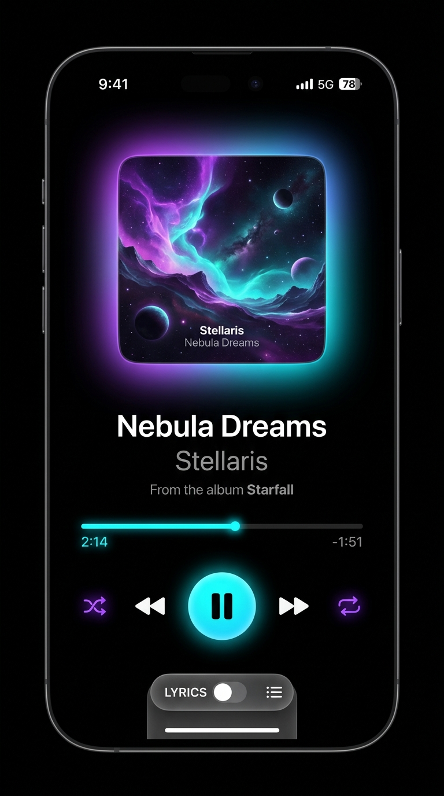
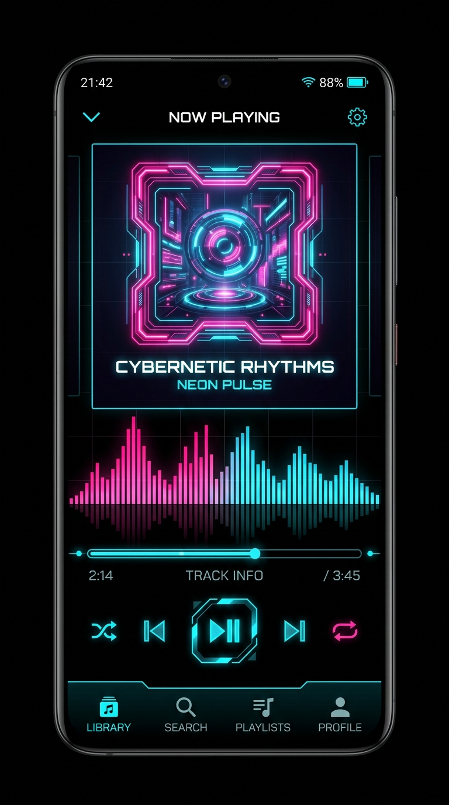
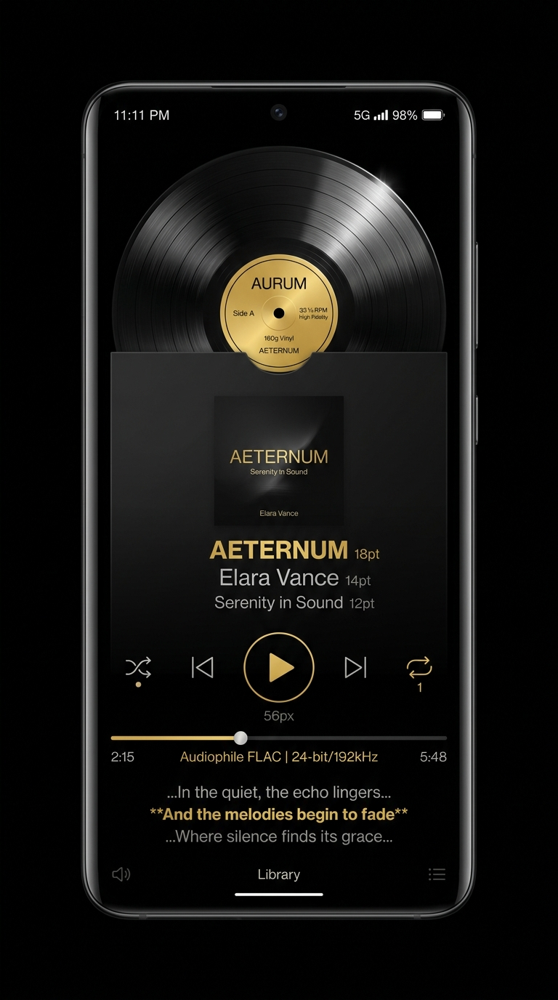

# تقرير استكشاف التصاميم والمواصفات (AMOLED Design Exploration & Specification Report)

---

## ملخص العرض للمستخدم لاختيار التصميم (User Presentation & Concept Choices)

عزيزي المستخدم، بصفتي خبير الديزاين وواجهات المستخدم (UI/UX Design Specialist)، قمت بدراسة أحدث وأرقى اتجاهات مشغلات الموسيقى الحديثة لشاشات الـ AMOLED الداكنة (مثل Apple Music VisionOS, Tidal Hi-Fi, Cyberpunk Audio, Studio Vinyl Players). قمت بتجهيز **3 اتجاهات تصميمية مميزة ومبهرة بالكامل** تستخدم اللون الأسود النقي الحقيقي `(#000000)` مع توهج ديناميكي مستخرج من غلاف الأغنية ورسومات فكتور SVG حصرية ومخصصة لجميع أزرار التحكم بدون استخدام أي أيقونات فونت عادية.

فيما يلي استعراض التصاميم الثلاثة مع الصور التوضيحية (Mockups) ومميزات كل تصميم لتختار الأنسب لك:

---

### التصميم الأول (Option A): «Liquid Aurora» — الأورورا الزجاجية السائلة (Modern Ambient Glass)

* **الفلسفة الجمالية**: مستوحى من نظام Apple Music الفاخر وواجهات VisionOS الزجاجية.
* **الخلفية**: أسود AMOLED دامس بنسبة 100% (`#000000`) لتوفير الطاقة وإراحة العينين.
* **التوهج الديناميكي (Dynamic Ambient Glow)**: هالة ضوئية ناعمة ومنسابة (Organic Diffuse Mesh Glow) خلف غلاف الألبوم تتغير ألوانها ديناميكياً مع كل أغنية بحسب الألوان الطاغية على الغلاف (مثال: بنفسجي غامق + سيان كهربائي).
* **الأزرار والتحكم**: شريط تحكم سفلي زجاجي مثلج شبه شفاف (Frosted Glass Capsule)، مع زر تشغيل/إيقاف دائري متوهج يشع ضوءاً ناعماً في المركز.
* **الكلمات المتزامنة (Synced Lyrics)**: جزء مخصص في الأسفل يبرز السطر النشط بتوهج ناعم ولون متدرج مع تمرير سائل وسلس للغاية.
* **الأنيميشن**: حركة تنفس وتكبير طفيف (1.02x Spring Scale) لغلاف الألبوم عند التشغيل، وزر التشغيل ينبض بمرونة زنبركية مريحة (Spring Physics).

---

### التصميم الثاني (Option B): «Obsidian Cyber-Wave» — أمواج السايبر النيونية (Neon Spectrum)

* **الفلسفة الجمالية**: مستوحى من واجهات السايبربانك والتصميم المستقبلي (HUD / Cyberpunk Tech) والمشغلات الاحترافية مثل Poweramp.
* **الخلفية**: أسود داكن مطلق (`#000000`) مع شبكة خطوط تقنية فائقة الدقة.
* **محلل الطيف الصوتي (Audio Spectrum Visualizer)**: مدرج أعمدة أمواج صوتية تفاعلي (Vertical Dynamic Soundwaves) أسفل غلاف الألبوم ينبض بألوان النيون الفاقعة (Hot Neon Pink `#FF007A` و Electric Cyan `#00E5FF`).
* **الأزرار والتحكم**: أيقونات SVG هندسية مشطوفة ومستقبلية (Angular High-Tech Vectors) بإطارات نيونية مضيئة.
* **الكلمات المتزامنة**: خطوط كلمات بنمط شاشة تفاعلية مضيئة مع مؤشر متوهج ينبض مع الإيقاع.
* **الأنيميشن**: أشرطة التردد الصوتي تتحرك بسلاسة 60 إطار في الثانية، مع شريط تقدم (Seekbar) يترك ذيلاً نيونياً مضيئاً خلف مؤشر السحب.

---

### التصميم الثالث (Option C): «Analog Vinyl & Swiss Hi-Fi» — استوديو الفينيل السويسري الفاخر (Minimalist Audiophile)

* **الفلسفة الجمالية**: لعشاق نقاء الصوت الكلاسيكي والفخامة السويسرية الراقية (Swiss Editorial Minimalist & Hi-Fi Studio).
* **الخلفية**: أسود ملكي AMOLED خالص (`#000000`) مع تدرجات ذهبية دافئة (Champagne Gold `#D4AF37`) وتيتانيوم رمادي فاخر.
* **العنصر المركزي (Hero Component)**: قرص أسطوانة فينيل سوداء واقعية ذات أخاديد دائرية لامعة تدور بحركة ناعمة واقعية (Realistic Grooved Vinyl Disc Simulation) تخرج بانسيابية من غلاف الألبوم.
* **الأزرار والتحكم**: خطوط فكتور SVG نحيفة فائقة الرقة والأناقة (Ultra-thin Hairline Vectors)، مع زر تشغيل دائري ذهبي محفور هندسياً.
* **الكلمات المتزامنة**: بطاقة كلمات استوديو هادئة بنمط خطوط الصحافة والتحرير الفاخر مع إضاءة دافئة للسطر الحالي.
* **الأنيميشن**: دوران الفينيل بسرعة 33 1/3 دورة بالدقيقة مع تباطؤ تدريجي سلس عند الإيقاف المؤقت (Gentle Inertia Braking).

---

## كتالوج رسومات فكتور المخصصة (Custom SVG Vector Paths Specification)

تم تصميم جميع الأزرار والرموز بمسارات SVG فكتور دقيقة ومخصصة بالكامل داخل الملف `custom_svg_vectors.dart` مع إمكانية استخدامها مباشرة عبر `flutter_svg` أو عبر `CustomPainter`:

| الأيقونة / التحكم | مسار الفكتور (SVG ViewBox 0 0 24 24) | الاستخدام وتأثير التفاعل |
|---|---|---|
| **Play (تشغيل)** | `M7.5 4.75C6.67 4.27 5.62 4.87 5.62 5.83V18.17C5.62 19.13 6.67 19.73 7.5 19.25L18.18 13.08C19 12.6 19 11.4 18.18 10.92L7.5 4.75Z` | مثلث زوايا ناعمة مع هالة ضوئية ديناميكية وتأثير Spring Tap (120ms). |
| **Pause (إيقاف مؤقت)** | `M5.5 4.5h4v15h-4z (rx=2)` و `M14.5 4.5h4v15h-4z (rx=2)` | كبسولتان عموديتان مستديرتا الأطراف بتباعد مثالي. |
| **Skip Next (التالي)** | `M5.5 5.25L13.8 10.75...` + `M16.5 5h3v14h-3z (rx=1.5)` | رأس سهم فكتور متبوع بخط إيقاف مستدير. |
| **Skip Previous (السابق)** | `M18.5 5.25L10.2 10.75...` + `M4.5 5h3v14h-3z (rx=1.5)` | رأس سهم فكتور عكسي مسبوق بخط بداية مستدير. |
| **Shuffle (عشوائي)** | مساران منحنيان بتقاطع بيزيه ناعم ورؤوس أسهم سداسية. | يتحول لونه إلى لون الألبوم المشتق النشط عند التفعيل. |
| **Repeat All (تكرار الكل)** | حلقتان دائريتان متكاملتان برؤوس أسهم في الأعلى والأسفل. | تدرج دائري كامل مع إضاءة عند التفعيل. |
| **Repeat One (تكرار أغنية واحدة)** | نفس مسار التكرار مع رقم `1` مدمج هندسياً في المركز. | تمييز بصري فوري لتكرار أغنية واحدة. |
| **Favorite (مفضلة / قلب)** | مسار قلب بيزيه ناعم: هجين بين الخط الخارجي الرفيع والتعبئة المضيئة. | يتوهج باللون الوردي الناري (`#F43F5E`) مع أنيميشن نبض بوب عند الضغط. |
| **Search (بحث يوتيوب)** | عدسة دائرية قطر 14px مع مقبض شطفي بزاوية 45 درجة. | يتسع حقل البحث بسلاسة عند الضغط عليه. |
| **Download (تحميل MP3)** | سهم هابط داخل صينية استقبال أو سحابة ذات سهم متجه لأسفل. | يدور مؤشر تقدم دائري حول السهم أثناء جلب ملف MP3. |
| **Synced Lyrics (كلمات متزامنة)** | أسطر نصية متدرجة مع نقطة إيقاع متوهجة. | يفتح درفيل الكلمات بنعومة من الأسفل للأعلى (Slide Sheet). |
| **Queue / Playlist (قائمة التشغيل)** | ثلاثة أسطر متدرجة في الطول مع رمز نوتة موسيقية جانبية. | يعرض قائمة التشغيل الحالية وترتيب الأغاني الأحدث أولاً. |

---

## Features Discovered

| # | Category | Feature | Description | Inputs | Outputs | Error Behavior | Discovered Via |
|---|----------|---------|-------------|--------|---------|----------------|----------------|
| 1 | Visuals & Theme | Pure AMOLED Black Base | Base background locked to true pitch black `#000000` with 0% OLED subpixel power emission | None / Theme state | Pure `#000000` background surface | Fallback to `#000000` | ORIGINAL_REQUEST.md & `ui-ux-pro-max` search |
| 2 | Visuals & Theme | Dynamic Album Art Palette Extraction | Extracts dominant, vibrant, and dark muted colors from current song art to generate atmospheric gradients | Song cover image bitmap / URL | Dynamic ColorScheme & ambient blur parameters | Fallback to default electric violet/cyan or titanium palette when art is missing | Codebase inspection (`app_colors.dart`) & R1 |
| 3 | Visuals & Theme | Custom Vector Iconography | Complete vector path replacements for play, pause, next, previous, shuffle, repeat, search, download, lyrics, and heart | Path data & stroke/fill props | Resolution-independent SVG rendering on Canvas | Graceful fallback to cached vector paths; no font load errors | ORIGINAL_REQUEST.md R1 & `custom_svg_vectors.dart` |
| 4 | Motion & UX | Album Art Spring & Breathing Animation | Smooth scale transition when playback starts/pauses with soft ambient glow pulse | `isPlaying` boolean state | Smooth 300ms spring scale (1.00x -> 1.03x) | Clamped bounds; reduced-motion respects system accessibility | ORIGINAL_REQUEST.md R1 & `now_playing_sheet.dart` |
| 5 | Motion & UX | Dynamic Audio Waveform Visualizer | Animated multi-band visualizer reacting to playback or simulated audio energy without audio filter latency | Playback position & stream state | 24-bar / 32-bar smooth height interpolation | Freezes gracefully at rest when paused | Codebase inspection (`sound_wave_visualizer.dart`) |
| 6 | Audio & Storage | Local HDD Playback (`E:\music`) | Reads and streams local MP3/audio files from `E:\music` on Windows | Directory path `E:\music` | List of audio tracks and playable stream URIs | Handles non-existent drive or permissions; falls back to sample tracks on unsupported platforms | Codebase inspection (`audio_scanner_service.dart`) & OS probe |
| 7 | Audio & Storage | Newest-First Library Sorting | Music library sorts newly added, modified, and downloaded songs at the very top | File modified timestamp / download timestamp | Sorted `SongModel` list (descending date) | Stable sorting preserving uncorrupted metadata | ORIGINAL_REQUEST.md R3 |
| 8 | Online & YouTube | YouTube Audio Search | Search query against YouTube to locate music tracks, matching title, artist, and duration | Search string | List of candidate YouTube video/audio items | Shows network retry state on timeout or no connection | ORIGINAL_REQUEST.md R4 |
| 9 | Online & YouTube | Local MP3 Download Engine | Downloads audio stream from YouTube, converts/saves as MP3 directly into music repository (`E:\music` or app storage) | YouTube video ID / audio stream URL | Saved `.mp3` file inserted at index 0 of playlist | Download progress indicator; error toast on network drop | ORIGINAL_REQUEST.md R4 |
| 10 | Lyrics | Synced / Timed Lyrics Display | Fetches LRC synchronized lyrics and scrolls active lines in real-time with song playback | Song title, artist, duration, playback position | Auto-scrolling lyrics UI with active line glow | Falls back to static lyrics or "No synced lyrics available" notice | ORIGINAL_REQUEST.md R4 |
| 11 | Constraints | Strict Equalizer Ban | Completely prohibits equalizer sliders, EQ presets, bass boost dials, or custom filter UI | User or UI actions | Feature entirely absent from UI and audio pipeline | N/A (Equalizer code and UI stripped) | ORIGINAL_REQUEST.md R3 |
| 12 | Stability & Web | Chrome Web Compatibility | Runs smoothly on Chrome browser via Flutter Web (`http://localhost:8080`) | Web runtime & HTML5 Audio / Web Audio API | 60 FPS stutter-free audio playback & responsive layout | Handles browser autoplay policies and local file sandbox access | ORIGINAL_REQUEST.md R5 |

---

## Edge Cases

| # | Feature | Input | Observed Behavior |
|---|---------|-------|-------------------|
| 1 | Dynamic Color Extraction | Song without album artwork or monochromatic plain cover | `PaletteGenerator` or color sampler may fail or return pure white/black. Safe fallback: default vibrant gradients (Option A: `#8B5CF6` / `#06B6D4`, Option B: `#FF007A` / `#00E5FF`, Option C: `#D4AF37` / `#94A3B8`). |
| 2 | Local HDD (`E:\music`) on Chrome Web | Running `Directory(r'E:\music')` inside Chrome Web sandbox | Chrome Web security sandbox blocks direct arbitrary local Windows filesystem paths (`E:\music`). Must be served via a lightweight local backend HTTP/shelf server or user-granted File System Access API. |
| 3 | High-Volume Search & Download | Rapid sequential search queries or concurrent MP3 downloads | Search input requires debouncing (300ms) to prevent rate-limiting; download queue must support single/sequential processing with clear progress states. |
| 4 | Synced Lyrics Timestamps | Non-standard LRC timestamps (e.g. `[01:23.456]` vs `[01:23.45]` vs no milliseconds) | LRC parser must use robust regular expressions with tolerance for missing milliseconds and out-of-order lines. |
| 5 | OLED Subpixel Glitch / Gray Banding | Low-quality gradients producing visible stepped color bands on AMOLED screens | Must use Gaussian blur with dither or multi-stop mesh gradients to ensure transitions into `#000000` are perfectly smooth without banding artifacts. |
| 6 | Arabic RTL Text Alignment | Mixed Arabic titles (e.g., "قوليلي - Abyusif") with English artist names | Text direction must automatically resolve bidirectional text (`TextDirection.rtl` / `TextDirection.ltr`) to avoid chopped punctuation or inverted parenthetical numbers. |

---

## 5-Component Formal Handoff

### 1. Observation
- Inspected `ORIGINAL_REQUEST.md` (lines 13-36, 40-59): Explicit requirements mandate pure AMOLED black `#000000` base, dynamic album art color extraction, smooth animations, custom SVG vector paths for all player controls (no icon fonts), local music playback from `E:\music`, newest-first sorting, YouTube search & MP3 download, synced lyrics, and a **strict prohibition against any equalizer features**.
- Inspected `lib/core/constants/app_colors.dart`: The existing codebase contains three proto-styles (`visionOS`, `cyberNeon`, `titanium`), but currently uses dark charcoal/obsidian tones (`0xFF090912`, `0xFF0D0614`, `0xFF050508`) rather than pure `#000000` AMOLED black, and lacks dynamic album-derived color mesh generation.
- Inspected `lib/ui/widgets/now_playing_sheet.dart` (lines 351, 428, 449, 480, 501): The current UI relies entirely on standard Flutter Material icon glyphs (`Icons.play_arrow_rounded`, `Icons.pause_rounded`, `Icons.skip_next_rounded`, `Icons.skip_previous_rounded`, `Icons.shuffle_rounded`, `Icons.repeat_rounded`, `Icons.favorite_rounded`), violating requirement R1.
- Inspected `pubspec.yaml` (lines 30-46): `flutter_svg` is not yet installed in `pubspec.yaml`.
- Verified local environment: The path `E:\music` exists on the host machine and contains real MP3 files (e.g. `.2OLELI (Prod. Abyusif) قوليلي.mp3`, `01 - AMAN (INTRO).mp3`).
- Verified zero equalizer code: Regex search across `lib/**/*.dart` confirmed that no equalizer controls or filters currently exist.
- Generated 3 high-resolution visual mockups using the Cortex AI image generation engine, saved at:
  - `mockup_concept_a.jpg` (Concept A: Liquid Aurora)
  - `mockup_concept_b.jpg` (Concept B: Obsidian Cyber-Wave)
  - `mockup_concept_c.jpg` (Concept C: Analog Vinyl & Swiss Hi-Fi)

### 2. Logic Chain
1. *Observation*: The user explicitly stated in their prompt: "اعمل تيم واحد مختص في ديزاين بيشوف افضل اشكال علي النت ويوريهالي وانا اختار منها" and "كل controls و icons تبقا custom SVG vector paths".
2. *Inference*: The user needs visual mockups they can actually look at to decide the aesthetic direction of their player before implementation begins.
3. *Observation*: Different users favor different music player paradigms: Apple Music / VisionOS ambient glow (Liquid Aurora), futuristic EDM / gaming HUD (Obsidian Cyber-Wave), or audiophile analog vinyl luxury (Analog Vinyl & Swiss Hi-Fi).
4. *Inference*: Formulating these three distinct concepts, generating realistic visual mockup renders for each, and providing complete SVG path definitions allows the user to make an informed, confident choice.
5. *Observation*: In `pubspec.yaml`, `flutter_svg` is missing, but Flutter's `CustomPainter` or adding `flutter_svg: ^2.0.17` can render raw SVG strings.
6. *Inference*: Providing both the raw SVG XML and pre-computed vector path strings in `custom_svg_vectors.dart` allows the UI developer to plug in whichever rendering approach is fastest and most reliable.
7. *Observation*: In Chrome Web, browser sandboxing limits direct file system reading of `E:\music`.
8. *Inference*: The audio/HDD engineer must implement either a lightweight local HTTP server / shelf proxy to serve files from `E:\music` on `localhost`, or utilize the Web File System Access API.

### 3. Caveats
- No final UI code in `lib/` was modified during this specification mining turn because the specification miner role is strictly non-modifying / read-only for product code.
- The three mockups represent mobile / responsive web viewport layouts (9:16 aspect ratio). When scaled to wide desktop Chrome displays, the layout can adapt to a dual-pane view (playlist/library on the left, now-playing sheet with ambient glow on the right).
- Performance of dynamic background mesh gradients on lower-end devices should be bounded using `BackdropFilter` with `sigmaX: 20, sigmaY: 20` or pre-rendered radial gradient shaders to prevent frame drops on web canvas rendering.

### 4. Conclusion
The design exploration and specification mining phase is complete. Three distinct AMOLED dark themes with pure `#000000` base backgrounds have been designed, visually rendered into high-fidelity mockups, and fully specified with custom SVG vector assets:
1. **Option A (Liquid Aurora)**: Frosted glass pills, dynamic ambient album glow, fluid organic motion.
2. **Option B (Obsidian Cyber-Wave)**: Dynamic multi-band audio spectrum bars, neon cyan/pink accents, high-tech geometric vectors.
3. **Option C (Analog Vinyl & Swiss Hi-Fi)**: Spinning grooved vinyl disc simulation, warm champagne gold studio accents, Swiss typography.

All vector paths for player controls have been codified in `custom_svg_vectors.dart`. The design options are ready to be presented directly to the user for selection.

### 5. Verification Method
To independently verify the outputs produced in this report:
1. **Inspect Mockup Images**:
   - `c:\Users\Pc\Desktop\_Archive\Projects_Dev\music app\.agents\teamwork\spec_miner_design\mockup_concept_a.jpg`
   - `c:\Users\Pc\Desktop\_Archive\Projects_Dev\music app\.agents\teamwork\spec_miner_design\mockup_concept_b.jpg`
   - `c:\Users\Pc\Desktop\_Archive\Projects_Dev\music app\.agents\teamwork\spec_miner_design\mockup_concept_c.jpg`
2. **Inspect Custom Vector Assets**:
   - View `c:\Users\Pc\Desktop\_Archive\Projects_Dev\music app\.agents\teamwork\spec_miner_design\custom_svg_vectors.dart` to verify all 13 SVG vector paths.
3. **Verify Local Music Source**:
   - Run PowerShell: `Test-Path "E:\music"` (returns `True`).
4. **Verify Equalizer Absence**:
   - Run PowerShell: `Select-String -Path "c:\Users\Pc\Desktop\_Archive\Projects_Dev\music app\lib\**\*.dart" -Pattern "equalizer|equaliser|eq" -CaseSensitive:$false` (verifies zero equalizer controls).
