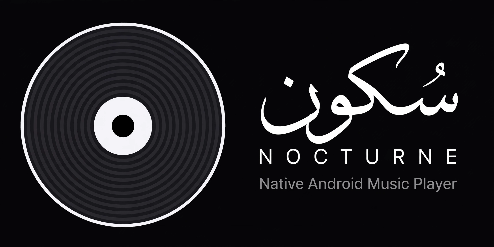
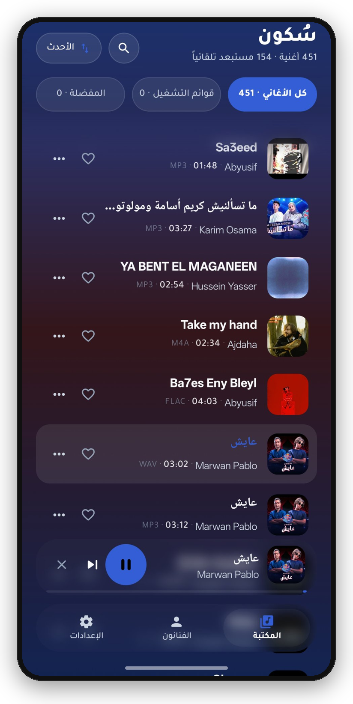
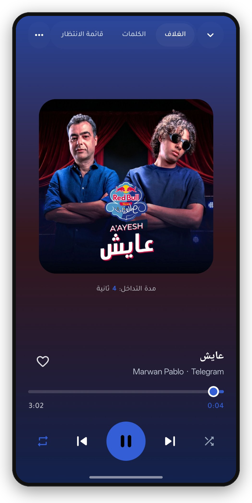
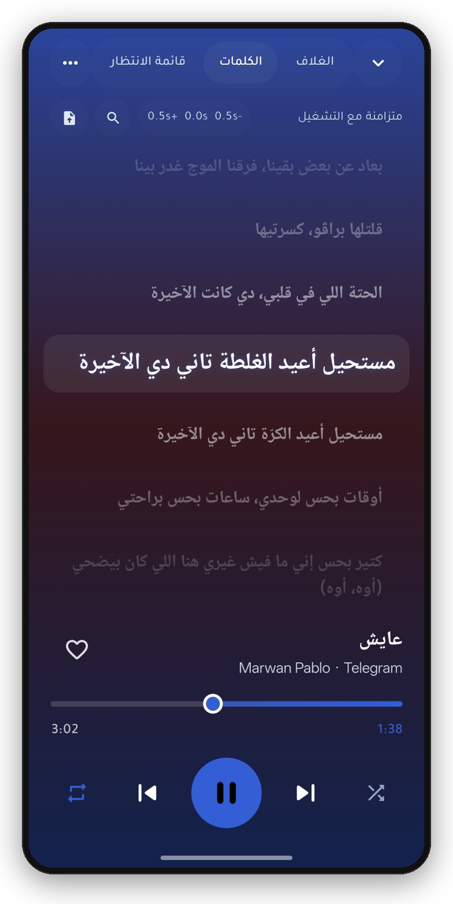
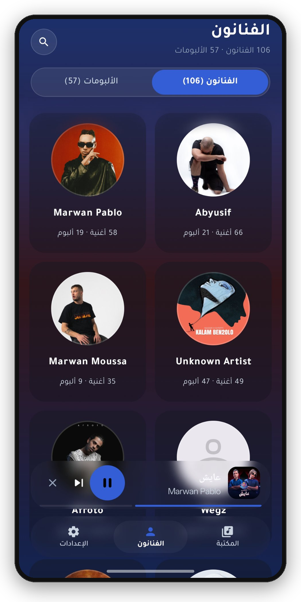
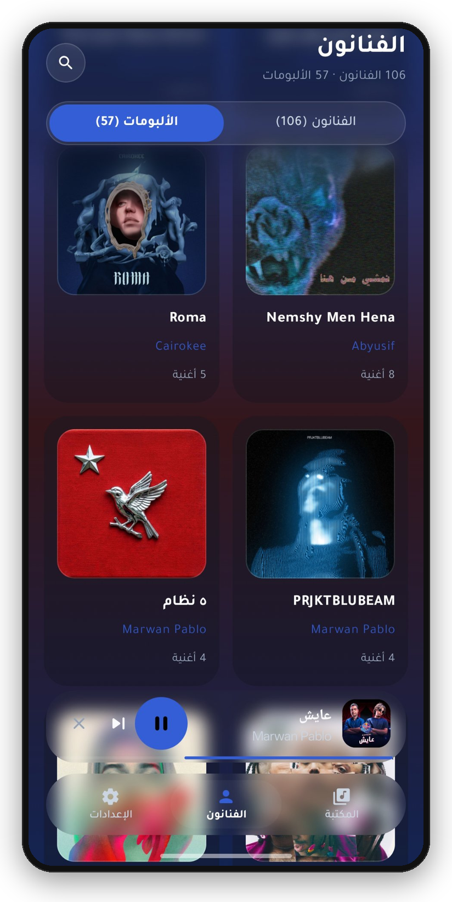

  

# سُكون - Nocturne (Kotlin + Jetpack Compose)

A native Android music player built with Kotlin, Jetpack Compose, Material 3, Media3 (`ExoPlayer` / `MediaSessionService`), and a Super AMOLED pure black (`#000000`) & translucent water-drop glass UI.

## Download

Get the latest APK from [Releases](https://github.com/ywsfw3778-code/music-app/releases).

## Screenshots

<table>
  <tr>
    <td align="center"> Library</td>
    <td align="center"> Player</td>
    <td align="center"> Synced Lyrics</td>
    <td align="center"> Artists</td>
    <td align="center"> Albums</td>
  </tr>
</table>

## Features

### Library

- **Local Music Library**: Scans device audio via `MediaStore.Audio.Media` with fast local caching, search, and sorting (Recent, Title, Artist, Duration).
- **Playlists & Favorites**: Create, edit, search-pick, delete, and drag-reorder playlists, plus one-tap favorites.
- **Artists & Albums**: Automatic artist normalization (`ArtistNormalizer`), junk-album filtering, and online cover/photo fetching via Deezer & iTunes (`OnlineMetadataResolver`) with local disk caching.
- **Smart Filtering & Folders**: Auto-exclude recordings, minimum duration threshold, custom keyword filters, quarantine restore page, and per-folder exclusion controls.

### Playback

- **Background Playback & Dual-Deck Crossfade**: `PlaybackService` (`MediaSessionService`) paired with `PlayerViewModel` for equal-power crossfade transitions, queue management, repeat modes, shuffle, and sleep timer.

### Lyrics

- **Synced & Plain Lyrics**: Automatic and manual search via LRCLIB (`LyricsRepository`), Franco-Arabic normalization, local `.lrc` file import, tap-to-seek lines, and timing offset adjustments (`-0.5s` / `+0.5s`).

### Look & Feel

- **Bilingual & Adaptive Appearance**: Full Arabic (RTL) and English support, dynamic cover-extracted accent colors, and configurable artwork/blur backdrop modes.

## Project Structure

- `app/src/main/java/com/example/` — Application entry (`MainActivity`), `PlayerViewModel`, `PlaybackService`, `data/`, `model/`, `ui/` (`components/`, `screens/`, `theme/`)
- `app/src/main/res/` — Strings, adaptive launcher icons, fonts, and themes
- `app/src/test/` — Unit and Robolectric tests

## Build & Test

- `applicationId` (GitHub releases): `com.kyouma.sukoon`
- `minSdk`: `24`, `targetSdk`: `36`, `compileSdk`: `36`
- Run unit tests: `gradle :app:testDebugUnitTest`

> Note: the `com.apple.android.music` package name is for the developer's personal phone build only. GitHub releases use `com.kyouma.sukoon`.
